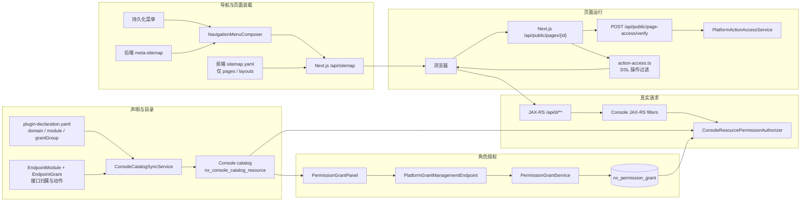
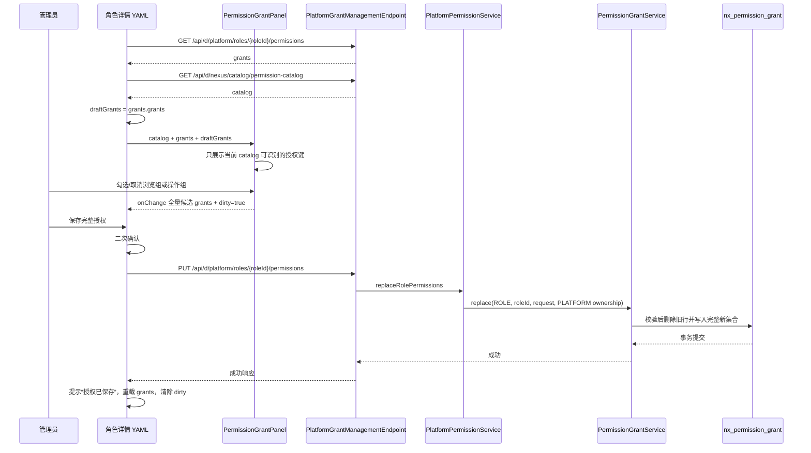
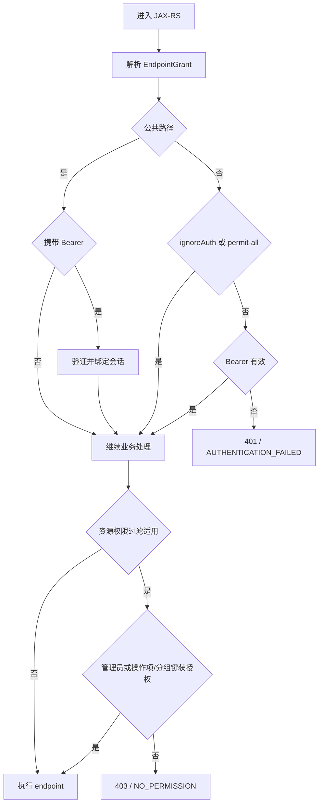
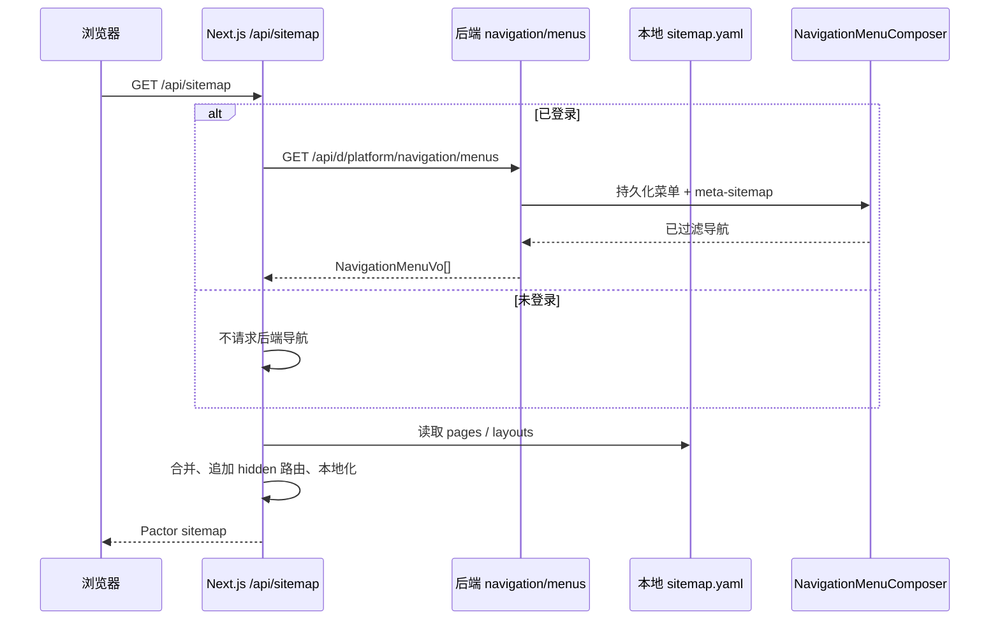
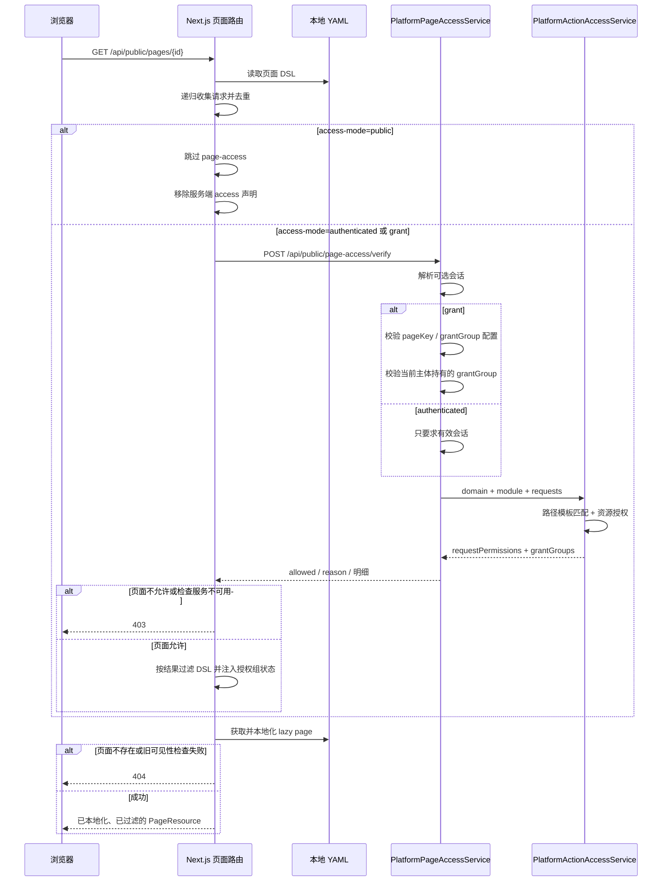

# 控制台接口、角色、导航与页面鉴权设计（当前实现）

> 实现基线：2026-11-05
> 适用范围：`innospots-nexus-platform`、`innospots-nexus-console`、`innospots-nexus-core`、示例 Spring 应用，以及 `innospots-nexus-ui/innospots-nexus-ui-console`。

本文按当前代码的实际行为描述平台控制台鉴权，不描述尚未落地的通用权限平台能力。代码、插件声明和运行配置是事实来源。

鉴权分为四层：请求侧后端鉴权是最终安全边界；导航决定入口是否展示；页面访问检查决定 Next.js 是否返回页面 DSL；操作过滤只决定 DSL 中哪些组件和事件可展示、可执行。后三层不能替代请求侧鉴权。

## 1. 总体结构与调用边界



### 1.1 实现边界与职责归属

- 平台权限端点及页面统一访问检查的编排归 `innospots-nexus-platform`。
- console 提供通用 catalog、角色授权、请求授权判定、导航组合和 JAX-RS 过滤器；core 的 `EndpointGrantManager` 负责 endpoint grant 注册与匹配。
- 示例 Spring 应用只负责装配配置和 Bean，不承载通用授权规则；页面 DSL 的收集、转换和组件过滤在 console UI 的 Next.js 服务端完成。
- 实现遵循现有的 `base -> core -> console -> platform` 依赖方向，不新增模块、数据库表或基础库公开契约。
- 不新增权限实体、枚举或状态码；拒绝和异常继续使用现有 `NexusException`、状态码及响应契约。
- 页面统一检查保留原四参数 Java 请求构造器以兼容既有消费者；旧的 `/api/d/platform/permissions/action-access` HTTP 入口已移除。

## 2. 授权键与主体模型

### 2.1 稳定资源键

catalog v2 的资源键格式为：

```text
{domainKey}.{moduleKey}:{grantName}
```

例如：

| 用途 | 资源键示例 |
|---|---|
| 角色模块浏览组 | `operation.role:view` |
| 角色创建操作组 | `operation.role:create` |
| 单个操作项 | `operation.role:role.create` |

`domainKey`、`moduleKey`、`grantGroup` 和 `EndpointGrant.name` 都是稳定标识；展示文案不能参与鉴权。

当前角色授权界面按 `grantGroup` 勾选并保存。请求侧鉴权器接受同一 endpoint 的“操作项键”或“分组键”之一，以兼容已有数据：

- READ/EXPORT 通常通过浏览分组键放行，例如 `operation.role:view`。
- 变更类操作通常通过操作分组键放行，例如 `operation.role:create`。
- catalog 中仍会生成 `operation.role:role.create` 这类操作项键，供目录展示、兼容和细粒度授权使用；新增角色授权默认保存分组键。

### 2.2 主体与归属

控制台授权主体包括 `ROLE` 和 `ORG_UNIT`。当前主体命中的角色授权和组织单元授权取并集。

- 普通主体只命中已持久化的资源键。
- `AuthorizationSubject.administrator()` 为 true 时直接放行。
- 授权键集合包含 `*` 时也按全量放行处理。
- PLATFORM 会话使用平台 ownership。
- 非 PLATFORM 会话必须提供 workspace，并按对应 ownership 查询授权。

## 3. 插件目录、模块和 Endpoint 声明

### 3.1 console@2 插件声明

`innospots-nexus-platform/src/main/resources/META-INF/innos-resources/plugin-declaration.yaml` 使用 `nexus.plugin/v1`，并贡献 `console` majorVersion `2`。每个 contribution 定义 `domainKey`，每个模块定义 `moduleKey`、`entryPageKey`、`viewGroups` 和 `operationGroups`。

当前 platform contribution 包括：

- `system`：`settings`、`theme`、`logger`、`dictionary`。
- `operation`：`role`、`user`、`organization`。

`system.plugin` 由 console 内置 plugin-management contribution 提供，不在 platform 声明中。

```yaml
# 节选，实际值以 plugin-declaration.yaml 为准
- moduleKey: role
  entryPageKey: platform-role-main
  viewGroups:
    - group: view
      label: { zh: 浏览角色管理页面, en: Browse role management pages }
  operationGroups:
    - group: create
      label: { zh: 创建, en: Create }
```

`ConsoleCatalogSyncService` 将已激活的 console@2 contribution 同步到 `nx_console_catalog_resource`。同步会新增、更新或禁用缺失的 MODULE/MENU 索引；授权保存时只接受当前 catalog 中存在的资源键。

### 3.2 EndpointGrant 与默认值

`@EndpointModule` 声明实现类的模块和领域，`@EndpointGrant` 声明单个 REST 方法的动作、稳定业务名、授权组、审计和跳过策略。

| 属性 | 当前默认值/规则 |
|---|---|
| `EndpointModule.domain` | 空字符串，由宿主按 catalog 模块键解析唯一领域 |
| `EndpointModule.ignoreAuth` / `ignorePermission` | `false` |
| `EndpointGrant.action` / `name` | 必填 |
| `EndpointGrant.group` | 空；READ/EXPORT 解析为 `view`，其余动作解析为 `operate` |
| `EndpointGrant.recordArgs` | `true` |
| `EndpointGrant.auditLog` | `false` |
| `EndpointGrant.label` | 空 |
| `EndpointGrant.ignoreAuth` / `ignorePermission` | `false`，与模块级值做 OR |

```java
@EndpointModule(value = "role", domain = "operation")
class ExampleRoleEndpoint {
    // 实际 JAX-RS 路径和 HTTP 注解由契约/实现共同组成。
}

@EndpointGrant(
        action = EndpointGrantAction.CREATE,
        name = "role.create",
        group = "create")
void createRole() {
    // 形状示例，不是可直接复制的完整 endpoint。
}
```

catalog 分组组装规则：

1. `viewGroups` 直接生成浏览分组，每个分组在 catalog 中以组级 `resourceKey` 出现。
2. 操作分组由 `operationGroups` 声明和已注册 operable endpoint 共同组装。
3. endpoint 的显式 `group` 优先归入同名操作组。
4. `group` 缺省为 `operate` 时，会再按 action 尝试 `create`、`update`、`delete`、`status`、`execute`、`replace`、`assign`、`revoke`、`import`、`write`；都未命中且声明了 `operate` 时归入 `operate`。
5. 未在 `operationGroups` 中声明的分组不会出现在角色授权目录中。

代码入口：

- `innospots-nexus-core/src/main/java/com/innospots/nexus/core/endpoint/grant/EndpointGrant.java`
- `innospots-nexus-core/src/main/java/com/innospots/nexus/core/endpoint/grant/EndpointModule.java`
- `innospots-nexus-core/src/main/java/com/innospots/nexus/core/endpoint/grant/support/ResolvedEndpointGrant.java`
- `innospots-nexus-console/src/main/java/com/innospots/nexus/console/catalog/service/CatalogPermissionCatalogAssembler.java`

## 4. 角色授权数据、保存流程与事务语义

### 4.1 请求与响应形状

角色授权使用全量替换请求：

```json
{
  "grants": [
    {
      "resourceKey": "operation.role:view",
      "constraintDefinition": null
    },
    {
      "resourceKey": "operation.role:create",
      "constraintDefinition": null
    }
  ]
}
```

`constraintDefinition` 是历史 wire 字段，在 catalog v2 中只接受 `null`、空字符串或空白字符串；保存时会统一归一化为 `null`。非空值会以 `INVALID_PARAMETER` 拒绝，返回 `Constraint grants are not supported in catalog v2`。它不能用于 datasource 附加查询条件。

当前前端实际通常省略该字段，只提交 `{ "resourceKey": "..." }`。

### 4.2 持久化结构

`PermissionGrantEntity` 对应 `nx_permission_grant`：

| 字段 | 含义 |
|---|---|
| `grantId` | 授权行 ID |
| `subjectType` | `ROLE` 或 `ORG_UNIT` |
| `subjectId` | 角色或组织单元 ID |
| `grantKey` | catalog 资源键 |
| `grantKeyType` | `MODULE` 或 `MENU` |
| `constraintDefinition` | catalog v2 固定为 null |
| ownership 字段 | `ownerType`、`ownerId`、`securityRealm` 等 |

唯一索引组合为 ownership、安全域、主体类型/ID 和 `grantKey`。授权行按 ownership 隔离。

读取授权列表只按 ownership 查询，不强制校验主体当前仍在会话可见范围内，便于设置页回显。写入时会先通过 `GrantSubjectAccess.ensureSubjectInScope` 校验角色或组织单元属于当前 ownership，避免跨归属写入。

### 4.3 全量替换校验

`PermissionGrantService.replace` 在一个事务内完成：

1. 校验主体类型和主体 ID。
2. 校验主体属于当前 ownership。
3. 校验请求中的资源键：非空、单个长度不超过 256、同一请求不能重复、必须存在于当前 catalog。
4. 删除该主体在当前 ownership 下的旧授权。
5. 按请求顺序重新写入授权，并解析 `grantKeyType`。
6. 任一校验或写入失败时整体回滚。

`grants` 为 `null`、`[]` 或缺失时都会归一化为空集合，表示清空该主体的授权。

### 4.4 角色授权界面与保存时序

实际角色权限设置位于 `role-detail-basic.yaml` 的 `permissions` Tab。`role-detail-permissions.yaml` 只是兼容路由，会导航到该 Tab。



界面行为：

- catalog 中的 `viewGroups` 按组展示。
- `operationGroups` 也只按组勾选；组内操作项用于后端鉴权兼容，不要求用户逐项勾选。
- 已选集合以 `draftGrants` 为准；取消后重新载入服务端的 `grants`。
- 保存按钮只在 `dirty=true` 时可用。
- `PermissionGrantPanel` 通过自定义组件 `access.mode: disable` 声明保存请求；没有 PUT 权限时组件保留为只读，保存动作不可执行。

当前 Pactor `ActionEngine.executeAll` 串行执行 action 数组，但不会因前一个 action 返回 `{ ok: false }` 自动短路。角色授权 YAML 的保存请求后仍直接声明“授权已保存”提示，也没有以命名 action 结果设置 `condition`。因此当前 UI 的成功提示不能单独作为保存成功证据；最终结果应以后端响应、事务结果和重新读取的 `grants` 为准。若产品要求失败时禁止成功提示，需要另行调整 action 链或让 `executeAll` 支持显式失败短路策略。

## 5. JAX-RS 请求过滤器与最终鉴权

### 5.1 执行顺序

相关 `@Priority` 顺序如下，数值越小越早执行：

| 顺序 | 过滤器 | 优先级 | 作用 |
|---|---|---|---|
| 1 | `ConsoleCorsFilter` | `50` | CORS 预检与响应头 |
| 2 | `ConsoleResolvedEndpointGrantFilter` | `AUTHENTICATION - 100` | 解析资源类/契约方法上的 endpoint grant，并绑定到请求 |
| 3 | `ConsoleAuthenticationFilter` | `AUTHENTICATION` | 公共路径、skip-auth 分支；其余验证 Bearer |
| 4 | `ConsoleDevSessionFilter` | `AUTHENTICATION + 10` | 安全关闭时按开发配置绑定会话 |
| 5 | `ConsoleResourcePermissionFilter` | `AUTHENTICATION + 100` | 对命中的控制台资源和当前主体执行授权 |
| 6 | `ConsoleRequestContextFilter` | `USER` | 请求 ID、请求上下文 |
| 7 | `ConsoleAuditLogFilter` | `USER + 100` | 按 endpoint 审计配置记录结果 |

### 5.2 认证分支

默认公共路径为：

```text
/api/public/**
/api/d/*/public/**
```

公共路径上的行为：

- 未携带 Bearer：匿名继续，由业务逻辑决定是否要求会话。
- 携带 Bearer：解析并验证 token；token 无效仍然失败，不会静默降级为匿名。

其他路径按以下顺序继续：

1. `security.enabled=false` 时认证与资源权限过滤器直接跳过。
2. `ResolvedEndpointGrant.ignoreAuth=true` 时跳过登录要求。
3. 命中配置的 permit-all Ant 模式时跳过登录要求。
4. 其余请求必须携带有效 Bearer。

`ignoreAuth` 不自动跳过资源权限；`ignorePermission` 也不自动跳过登录。两者语义独立。

### 5.3 资源权限分支

`ConsoleResourcePermissionFilter` 默认只处理 `/api/d/**`。以下任一条件成立时跳过资源权限校验：

- 安全功能关闭。
- 没有解析出 `ResolvedEndpointGrant`。
- endpoint 或模块设置了 `ignorePermission=true`。
- 请求属于公共路径。
- 请求不匹配 `consolePathPatterns`。

重点关注：当前实现不会把所有“没有 `@EndpointGrant` 的接口”自动转换成拒绝。因此，新增 `/api/d/**` 资源接口时仍必须声明 endpoint grant，并依赖测试和代码评审检查遗漏。

命中资源权限校验时：

1. 非 PLATFORM 会话必须具有 workspace。
2. 解析当前主体；无法解析时返回认证失败。
3. 根据 `domainKey.moduleKey:name` 组装操作项键。
4. 根据 `domainKey.moduleKey:grantGroup` 组装分组键。
5. 操作项键或分组键任一命中当前角色/组织单元授权即通过。
6. 管理员直接通过；普通主体均未命中时返回 `NO_PERMISSION`，默认 HTTP 403。



## 6. 导航定义、合并、过滤与本地化

### 6.1 两个后端来源

后端导航不是只来自 `meta-sitemap.yaml`。`NavigationMenuComposer` 组合两类菜单：

1. 数据库中的持久化菜单，由 `NavigationMenuAssembler` 按 ownership 和主体权限组装。
2. `innospots-nexus-sample/innospots-nexus-sample-spring-platform/src/main/resources/console/meta-sitemap.yaml` 中的默认菜单。

组合时持久化菜单排在前面，meta-sitemap 默认菜单追加在后；当前没有按菜单 ID 去重或覆盖，因此持久化菜单和默认菜单不应重复定义同一入口。

`/api/d/platform/navigation/menus` 要求登录，但设置 `ignorePermission=true`。它返回的是 JAX-RS 鉴权后的当前主体导航；菜单项本身再经过授权过滤。

meta-sitemap 节点支持：

```text
id, type, pageId, title, layout, icon, domainKey, moduleKey,
viewGroup, order, public, hidden, activeMenu, roles, children
```

`viewGroup` 缺省为 `view`。加载时 `SitemapMenuGrantBinding` 会用当前 catalog 校验浏览授权键；键不存在时会清空该节点的 `domainKey/moduleKey/viewGroup` 绑定。这个行为只影响导航元数据，不能替代页面级 `access-mode` 检查和后端请求鉴权。

`MetaSitemapMenuFilter` 对默认菜单递归执行：

- 删除 `hidden=true` 节点。
- 有 catalog 绑定时，要求当前主体持有对应浏览组键，除非主体是管理员或拥有 `*`。
- `roles` 非空时，至少一个当前 roleId 命中；roleId 匹配，不使用 role code。
- `group` 的子节点全部被过滤时，移除该空分组。

### 6.2 Next.js 拼接

前端 `innospots-nexus-ui/innospots-nexus-ui-console/src/backend/pages/yaml/sitemap.yaml` 只维护：

- `pages`：页面 ID、路径、标题、版本、lazy、layout、activeMenu 等。
- `layouts`：布局 DSL。

该文件不再维护重复的 `menus`。Next.js `GET /api/sitemap` 的流程是：

1. 已登录时携带 Bearer 请求后端 `/api/d/platform/navigation/menus`。
2. 后端 401 时清理本地访问 token / platform-login cookie，并返回不含后端菜单的 sitemap。
3. 后端不可用或响应结构异常时返回 HTTP 502。
4. `convertNavigation` 将持久化导航字段转换为 Pactor 菜单。
5. 将后端菜单与本地 `pages`、`layouts` 合并。
6. 未出现在可见导航中的页面被追加为 `hidden=true` 路由，保证详情页直达和路由解析仍可用。
7. 页面和布局执行 i18n 本地化后返回浏览器。



### 6.3 标题本地化与悬停名称

菜单 title 的最终展示顺序为：

1. `common.menu.{menuId}.title`
2. page 节点存在时使用 `common.page.{pageId}.title`
3. 后端/配置中的 `title` 作为回退

页面标题使用 `common.page.{pageId}.title`，找不到时回退到 `pages[]` 中的 title。页面和 layout DSL 通过 Pactor `localizePageDsl` 处理 `$i18n{key:fallback}`。因此 YAML 中的中文是默认回退，不是最终展示协议。

左轨导航图标使用同一份已本地化 title：`NavigationShell` 在普通布局中通过 `RailTooltip` 显示名称，展开式 rail 直接显示文字；同时设置 `aria-label`。多语言切换后，Next.js 重新生成本地化 sitemap。

导航只控制入口。隐藏菜单或直接输入 URL 都不能绕过页面访问检查和真实 API 鉴权。应用 layout 常驻时，sitemap 不会因每次路由跳转而必然刷新；角色权限修改后通常需要重新加载页面或重新拉取 sitemap 才能看到新的入口集合。

## 7. 页面访问配置与统一 page-access 校验

### 7.1 YAML 页面声明

页面访问模式只声明在页面 DSL 的 `page` 下，不在本地 `sitemap.yaml` 重复定义：

```yaml
page:
  id: role-list
  access-mode: grant
  domain: operation
  module: role
  pageKey: platform-role-main
  grantGroup: view
```

规则：

- `access-mode` 必填，只能是 `public`、`authenticated` 或 `grant`。
- `page.id` 必须与 `sitemap.yaml` 的 page entry ID 一致。
- 页面 entry 必须 `lazy=true`，确保 Next.js 在返回页面时执行访问检查。
- `grant` 模式必须有非空 `domain`、`module`、`pageKey`。
- `group` 是 `grantGroup` 的兼容别名；两者都存在时当前代码优先使用 `group`。
- `grantGroup` 缺省为 `view`。
- `pageKey` 应等于目标模块的 catalog `entryPageKey`。
- `grantGroup` 必须存在于目标模块的 catalog 授权组中；当前主体还必须持有同值的授权键。

Pactor 页面 Schema 对 `page` 只强制已知必需字段，并允许额外业务扩展字段；`page.additionalProperties=true`。额外字段不会导致 YAML 校验失败。Nexus UI 自己的页面加载器仍会校验 `id`、`access-mode`、lazy 以及 `grant` 模式的必要字段。

### 7.2 三种访问模式

| 模式 | 页面访问判定 | 是否调用 page-access | 操作过滤 |
|---|---|---|---|
| `public` | 匿名可访问 | 否 | 不执行操作权限过滤，只移除服务端 `access` 声明 |
| `authenticated` | 必须存在有效会话 | 是，由 Next.js 服务端调用 | 根据当前请求权限过滤 DSL 操作 |
| `grant` | 必须有会话并持有指定页面 grantGroup | 是，由 Next.js 服务端调用 | 根据当前请求权限过滤 DSL 操作，并注入授权组 |

公开页面不是“所有操作都公开”。公开页面的操作请求仍需在真正请求后端时经过 JAX-RS 鉴权；`public` 只表示打开页面不需要页面访问授权。

### 7.3 请求与返回

浏览器只请求：

```text
GET /api/public/pages/{id}
```

不会直接请求 page-access。Next.js 服务端在该路由内执行：

```text
POST /api/public/page-access/verify
```

请求示例：

```json
{
  "accessMode": "grant",
  "domainKey": "operation",
  "moduleKey": "role",
  "pageKey": "platform-role-main",
  "grantGroup": "view",
  "requests": [
    {
      "method": "POST",
      "url": "/api/d/platform/roles"
    }
  ]
}
```

响应示例：

```json
{
  "allowed": true,
  "reason": null,
  "requestPermissions": {
    "POST:/api/d/platform/roles": true
  },
  "grantGroups": [
    "view",
    "create",
    "update"
  ]
}
```

该接口位于 `/api/public/**`，因此允许匿名调用，也允许可选 Bearer；平台业务层从有效会话解析主体。它把页面访问判定和操作请求判定合并为一次服务端调用。此前独立的 `/api/d/platform/permissions/action-access` 不保留为浏览器公开入口；操作鉴权由 `PlatformActionAccessService` 在 page-access 调用链内执行。

### 7.4 完整时序



错误语义：

- 页面访问被拒绝、无会话、权限服务不可用或返回结构无效：`/api/public/pages/{id}` 返回 403。
- 页面不存在，或 `getLazyPage` 的兼容可见性检查失败：返回 404。
- 未登录访问 `authenticated/grant` 页面时，拒绝响应带 `redirectTo` 登录页。
- `NEXUS_PAGE_ACCESS_DISABLED` 不再用于跳过这套检查。

## 8. YAML DSL 操作收集、批量鉴权和组件过滤

### 8.1 请求收集

`src/backend/pages/action-access.ts` 会递归遍历页面 DSL，包括事件链、嵌套 overlay/modal、显式 `access` 和后端返回前的节点结构。收集来源为：

- `action: request`，method 缺省为 GET。
- `action: call` 引用的命名 action；会继续展开其内部请求。
- 组件显式声明的 `access.requests[]`。

相同 `METHOD:url` 会去重。未定义的命名 action、非数组 `access.requests` 或缺失请求字段会生成不可通过的无效请求项。页面路由随后把结果作为 `PageAccessVerifyRequest.requests` 发送给平台。当前后端最多处理 256 项；超过上限时返回的明细不完整，前端按失败关闭处理。

当前 DSL 中可直接承载 `action: request` 的位置并不局限于某个固定组件。常见组合是：

- Button 的 `events.onClick`。
- Form/Button 的提交事件。
- 自定义组件的事件链。
- 事件中打开、随后包含受限组件的 overlay content。
- 自定义组件通过 `access.requests` 显式声明的必要请求。

因此过滤器按 DSL 结构递归，不依赖仅有的两类组件名。当前直接声明 request 的内置组件主要以 Button、Form 为主，复杂组件用 `access` 显式补充依赖。

### 8.2 后端路径模板匹配

`PlatformActionAccessService` 的判定过程：

1. method 去除空白并转大写。
2. URL 去掉查询参数，仅用路径匹配注册 endpoint。
3. 拒绝长度超过 2048、未以 `/api/` 开头、包含 `..`、`%`、`#`、`;`、反斜杠或重复斜杠的路径。
4. URL 中的动态片段必须是完整路径段表达式，例如 `${row.id}`、`${params.id}`；片段内其他表达式形式拒绝。
5. 将合法动态路径段视为未知值，与 JAX-RS 路径模板中的变量段比较。
6. 必须恰好命中一个 method + path 模板；找不到或命中多个均返回 false。
7. 公共接口，或同时 `ignoreAuth && ignorePermission` 的接口直接放行。
8. 非公共接口要求会话；仅 `ignorePermission` 的接口在登录后放行。
9. 其余接口复用 `ConsoleResourcePermissionAuthorizer`，结果与真实请求过滤器一致。

返回 map 的 key 为前端提交的原始 `METHOD:url`。即使匹配时已去掉查询参数，明细键仍保持前端原值。

### 8.3 组件级过滤策略

`applyActionAccess` 以不可变方式生成新 DSL，不修改源 YAML。判断依据包括：

- 当前组件显式 `access.grantGroups` 是否都在返回的 `grantGroups` 中。
- 当前组件或事件链中的请求是否全部返回 `true`。
- 组件的 `access.mode`。

| 组件/场景 | 无权限时 |
|---|---|
| Button | 移除整个 Button；其必要请求、事件链或显式授权组任一失败都会移除 |
| Form | 禁用表单字段和提交按钮，并移除失败的事件处理器 |
| 普通组件，自身 `access` 或请求被拒绝 | 移除组件 |
| 普通组件，仅某个事件被拒绝 | 保留组件，移除该失败事件，其他安全事件保留 |
| `access.mode: disable` 的自定义组件 | 保留组件，清空事件并设置 `props.disabled=true` |
| overlay/modal 内的受限组件 | 参与递归判断；如果打开 overlay 的事件依赖被拒绝内容，触发组件也可能被移除 |

`access.mode` 当前支持的效果是：

```yaml
- type: PermissionGrantPanel
  access:
    mode: disable
    grantGroups: [update]
    requests:
      - method: PUT
        url: /api/d/platform/roles/${params.id}/permissions
```

`access` 在服务端消费后会从返回 DSL 中移除。自定义 React 组件或自定义 action 如果内部自行发请求，无法仅靠 YAML 静态遍历发现；必须在 declaration 中显式列出必要请求或 grantGroup。真实后端仍会独立拒绝未授权请求。

### 8.4 grantGroup 可见性与 `when`

服务端根据请求中的 `domain`、`module` 返回当前主体拥有的授权组名称列表。过滤后向页面状态注入：

```text
state.grantGroupList   // string[]
state.grantGroups      // { [groupName]: true }
state.grantGroupsAll   // 当前主体是否拥有 "*"
```

`when` 表达式原样保留，由 Pactor Runtime 使用上述状态判断：

```yaml
- type: Button
  when: ${state.grantGroups.create}
  props:
    text: 新建
  events:
    onClick:
      - action: request
        params:
          method: POST
          url: /api/d/platform/roles
```

管理员或 `*` 授权会返回模块内全部授权组，并设置 `grantGroupsAll=true`。组件级 `access.grantGroups` 也接受 `*` 作为全量授权组判断。

### 8.5 失败关闭

- page-access 整体拒绝、无会话或服务不可用：不返回业务页面 DSL，页面路由直接 403。
- page-access 返回 `allowed=true`，但请求明细缺失、`grantGroups` 不是数组或结构不符合约定：把结果标记为不完整，缺失请求一律视为 false；相关 Button/Form 被移除或禁用，并在 DSL 顶部加入权限检查失败提示。
- 未知 endpoint、歧义路径、非法表达式或不支持的 URL：对应请求返回 false。
- 公开页面：跳过 page-access 和操作过滤，只移除服务端 access 声明；实际 API 请求仍必须通过后端鉴权。

因此前端过滤失败时不会静默放行，但也不能把前端结果当作安全凭证。

## 9. 排查路径与代码索引

### 9.1 推荐排查顺序

1. 插件声明中是否存在匹配的 `domainKey/moduleKey/group`，catalog 是否已同步。
2. endpoint 是否设置正确的 `@EndpointModule`、`@EndpointGrant.action/name/group`，方法是否被 grant manager 注册。
3. 当前用户角色/组织单元是否在正确 ownership 下持有操作项键或分组键。
4. 导航缺失时检查持久化菜单、meta-sitemap、catalog 浏览组、`roles` 和 `hidden`。
5. 页面打不开时检查 `access-mode`、`domain`、`module`、`pageKey`、`grantGroup` 以及 page-access `reason`。
6. 按钮缺失时检查 YAML 收集出的 `METHOD:url`、动态路径模板、`access.grantGroups` 和 `access.mode`。
7. 实际 API 失败时检查 JAX-RS 过滤器结果；不能仅用前端按钮是否可见推断后端权限。

### 9.2 主要实现文件

| 范围 | 文件 |
|---|---|
| 插件声明 | `innospots-nexus-platform/src/main/resources/META-INF/innos-resources/plugin-declaration.yaml` |
| endpoint 注解 | `innospots-nexus-core/src/main/java/com/innospots/nexus/core/endpoint/grant/` |
| catalog 同步与组装 | `innospots-nexus-console/src/main/java/com/innospots/nexus/console/catalog/` |
| 角色授权保存 | `innospots-nexus-console/src/main/java/com/innospots/nexus/console/permission/service/PermissionGrantService.java` |
| 请求授权判定 | `innospots-nexus-console/src/main/java/com/innospots/nexus/console/permission/authorization/ConsoleResourcePermissionAuthorizer.java` |
| JAX-RS 过滤器 | `innospots-nexus-console/src/main/java/com/innospots/nexus/console/jaxrs/filter/` |
| 页面与操作鉴权服务 | `innospots-nexus-platform/src/main/java/com/innospots/nexus/platform/permission/service/` |
| 导航组合与过滤 | `innospots-nexus-console/src/main/java/com/innospots/nexus/console/navigation/` |
| 后端 meta-sitemap | `innospots-nexus-sample/innospots-nexus-sample-spring-platform/src/main/resources/console/meta-sitemap.yaml` |
| Next.js sitemap 合成 | `innospots-nexus-ui/innospots-nexus-ui-console/src/backend/pages/sitemap.ts` |
| page-access 客户端 | `innospots-nexus-ui/innospots-nexus-ui-console/src/backend/pages/page-access.ts` |
| DSL 操作过滤 | `innospots-nexus-ui/innospots-nexus-ui-console/src/backend/pages/action-access.ts` |
| 角色授权界面 YAML | `innospots-nexus-ui/innospots-nexus-ui-console/src/backend/pages/yaml/role/role-detail-basic.yaml` |
| 授权面板组件 | `innospots-nexus-ui/innospots-nexus-ui-console/src/frontend/components/settings/permission-grant-panel.tsx` |
| Pactor 页面 Schema | `../pactor/packages/schema/src/schemas/page-dsl.ts` |
| Pactor action 执行语义 | `../pactor/packages/runtime/src/action/engine.ts` |

### 9.3 关键测试

| 验证点 | 测试 |
|---|---|
| 授权保存、事务和 ownership | `PermissionGrantServiceTest`、`PlatformPermissionServiceTest`、`PlatformPermissionGrantFlowIntegrationTest` |
| 请求过滤器与授权器 | `ConsoleResourcePermissionFilterTest`、`ConsoleResourcePermissionAuthorizerTest` |
| 页面访问 | `GrantGroupPageAccessVerifierTest`、`PlatformPageAccessServiceTest`、`PlatformPageAccessEndpointContractsTest` |
| 操作鉴权 | `PlatformActionAccessServiceTest`、`action-access.test.ts`、`dictionary-action-access.test.ts`、`role-detail-action-access.test.ts` |
| 导航合并与过滤 | `NavigationMenuComposerTest`、`MetaSitemapMenuFilterTest`、`PlatformNavigationMenuEndpointIntegrationTest` |
| Sitemap 加载 | `SitemapYamlLoadTest`、`SitemapYamlConfigTest`、`SitemapConfigLoaderTest` |
| 前端 page-access 协议 | `page-access.test.ts` |
| 串行 action 不自动短路 | `../pactor/packages/runtime/src/action/engine.test.ts` |

### 9.4 当前实现验收矩阵

| 层次 | 必须验证的场景 | 通过标准 |
|---|---|---|
| 后端请求授权 | `POST` 角色创建、`GET` 角色列表；公开接口、仅登录接口、未知接口；静态路径与动态路径模板；主体与 ownership 作用域；管理员和普通用户 | 允许与拒绝分别来自真实 endpoint grant、会话主体和 ownership 判定，不能只依赖按钮是否显示 |
| 页面访问 | `public`、`authenticated`、`grant`；页面 catalog 定位；匿名、有效会话、授权拒绝 | public 不调用 page-access；另外两种模式在 Next.js 装载 DSL 时调用一次统一接口，拒绝时不返回业务 DSL |
| DSL 操作过滤 | 嵌套 overlay/modal、表格、表单、Button、多请求事件链、自定义组件显式 `access`、`when` grantGroup、服务失败和结果缺失 | 任一必要请求被拒绝时移除 Button 或禁用 Form/可禁用组件；失败关闭；保留原有 `when` 逻辑；权限检查结果不能替代后端请求鉴权 |
| 端到端 | 分别使用 `admin`、`opt01`、`user01` 登录，检查导航、页面可访问性、可见操作和直接调用 API | 三种角色呈现符合各自授权，越权页面和操作不可用，直接调用越权 endpoint 仍返回拒绝 |
