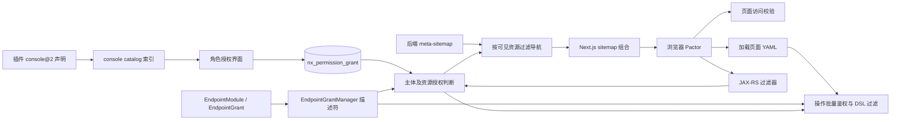
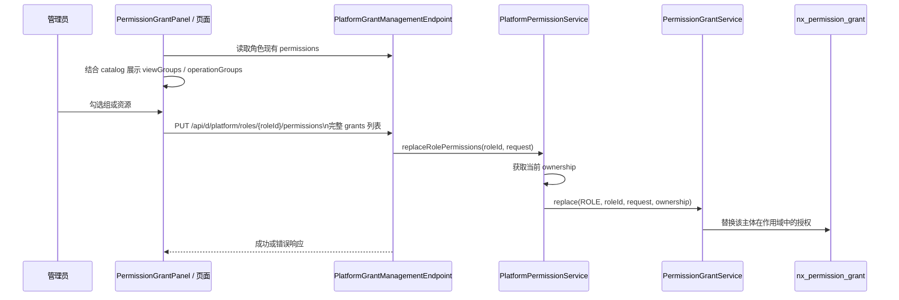
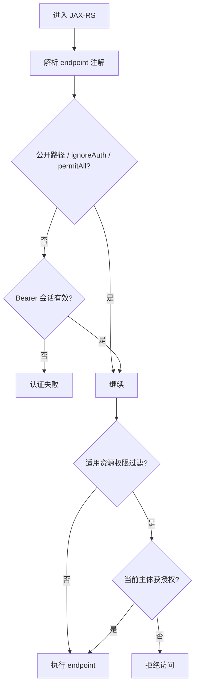

# 控制台接口、角色、导航与页面鉴权设计（当前实现）

本文描述当前仓库中的平台控制台实现，而不是预期中的通用权限平台。代码为事实来源；配置、开关及实例数据会改变运行结果。入口实现：`innospots-nexus-platform`、`innospots-nexus-console`、`innospots-nexus-core` 和 `innospots-nexus-ui/innospots-nexus-ui-console`。

## 1. 总体结构



权限有三个不同的使用点：导航决定入口是否显示；页面访问检查决定页面是否可打开；操作检查决定 DSL 中操作是否显示或可执行。它们不取代真实请求的后端过滤器。

## 2. 插件领域、模块与授权组

`innospots-nexus-platform/src/main/resources/META-INF/innos-resources/plugin-declaration.yaml` 使用 `nexus.plugin/v1` 的 `console` majorVersion 2 contribution。`domainKey` 标识领域，`modules[].moduleKey` 标识模块，`entryPageKey` 关联模块入口页面；模块下 `viewGroups` 和 `operationGroups` 分别描述浏览和操作授权分组。每组的 `group` 是稳定键，`label` 是展示名称。`children` 描述层级，`orderIndex`、`icon` 等用于目录展示。

当前 platform 插件贡献 `system`（settings、theme、logger、dictionary）和 `operation`（role、user、organization）。例如角色模块声明 `view`、`operate`、`create`、`update`、`delete`、`status`。`system.plugin` 来自 console 的插件管理 contribution，不在该 platform 声明中。导航浏览资源键的形式是 `domainKey.moduleKey:viewGroup`，例如 `operation.role:view`。插件声明中的组必须与 endpoint 的归属和组保持一致，名称相同但领域或模块不同并不代表同一个权限。

```yaml
# 节选：具体标签以 plugin-declaration.yaml 为准
- moduleKey: role
  entryPageKey: platform-role-main
  viewGroups:
    - group: view
      label: { zh: 浏览角色管理页面, en: Browse role management pages }
  operationGroups:
    - group: create
      label: { zh: 创建, en: Create }
```

插件 contribution 进入 catalog 后供角色授权界面、页面访问、导航和请求鉴权使用。插件显示名和导航 title 是展示信息，不是授权键。

## 3. Endpoint 配置与默认值

`@EndpointModule` 标注资源实现类，`value` 对应模块键，`domain` 对应领域键；`domain` 默认空，由宿主按 catalog 解析。`ignoreAuth` 和 `ignorePermission` 默认均为 `false`。`@EndpointGrant` 标注 REST 契约方法，可从接口解析；`action` 与 `name` 必填。`group` 默认空：READ/EXPORT 缺省按 `view`，变更类缺省按 `operate`；需要细粒度创建、更新、删除等组时必须显式声明。`recordArgs` 默认 true，`auditLog` 默认 false，`label` 默认空；方法级与模块级的两个 ignore 开关分别做 OR，方法不能用 false 覆盖模块 true。

```java
@EndpointModule(value = "role", domain = "operation")
class ExampleRoleEndpoint { /* 实现契约 */ }

@EndpointGrant(action = EndpointGrantAction.CREATE,
        name = "role.create", group = "create")
// 实际 REST 方法及 HTTP 注解应放在契约对应方法上
```

上述是配置形状示例，不是当前项目中可直接复制的完整 endpoint。读取类型和默认值见 `innospots-nexus-core/.../endpoint/grant/EndpointGrant.java`、`EndpointModule.java`；具体方法以各 endpoint 契约为准。`name` 是稳定业务名和审计对象，不应以页面按钮文案替代。

## 4. 角色授权数据与保存

目录资源与角色、组织单元的授权分离。`PermissionGrantReplaceRequest` 的结构为：

```json
{"grants":[{"resourceKey":"operation.role:view","constraintDefinition":null}]}
```

每项引用 catalog 资源键；`constraintDefinition` 是 datasource 附加查询条件，可为空。该请求是**全量替换**，空列表（包括归一化后的 null）表示清空授权。调用前必须先载入现有值并构造完整集合，不可把单次勾选当作增量提交。

持久化实体 `PermissionGrantEntity` 对应 `nx_permission_grant`：`grantId`、`subjectType`、`subjectId`、`grantKey`、`grantKeyType`、`constraintDefinition`，继承 ownership 字段。唯一索引组合为 owner type/id、security realm、subject type/id、grant key；`grantKeyType` 区分 MODULE / MENU。平台服务以当前平台会话的 ownership 调用 `PermissionGrantService`，角色主体类型为 ROLE；它也提供组织单元授权。授权数据不能由浏览器指定任意当前主体或 ownership 来绕过隔离。



面板维护已选资源键并过滤不在当前 catalog 中的键；禁用状态使用只读展示。实际保存请求和页面状态绑定见 `src/backend/pages/yaml/role/role-detail-permissions.yaml` 与 `src/frontend/components/settings/permission-grant-panel.tsx`。权限变更后的可见结果由后续请求重新计算；常驻 sitemap 的刷新行为见第 6 节。

## 5. 后端过滤器和授权判定

JAX-RS 请求过滤器的关键优先级（数值越小越早）：

| 顺序 | 过滤器 | 优先级 | 作用 |
|---|---|---|---|
| 1 | ConsoleResolvedEndpointGrantFilter | AUTHENTICATION - 100 | 根据资源类和方法解析注解并绑定请求 |
| 2 | ConsoleAuthenticationFilter | AUTHENTICATION | 公共路径、ignoreAuth、permitAll 等分支；否则验证 Bearer 会话 |
| 3 | ConsoleResourcePermissionFilter | AUTHENTICATION + 100 | 对适用的平台 console 请求执行资源授权 |
| 4 | ConsoleRequestContextFilter | USER | 请求上下文及响应请求 ID |

上述是相关过滤器的相对顺序；CORS、开发会话与审计过滤器还有各自职责，具体注册及条件见 Spring `ConsoleJaxRsWebConfiguration`。权限过滤器在安全功能关闭、无解析 grant 或 ignorePermission、公共路径、非 console 路径、非 PLATFORM scope 等情况下有跳过分支；因此不能声称所有未注解接口均自动拒绝。适用请求通过 `ConsoleResourcePermissionAuthorizer` 和当前主体判定，拒绝时返回权限错误。公开、仅需登录、资源授权三个概念必须分别检查：`ignorePermission` 不等于 `ignoreAuth`。



## 6. 导航定义和过滤

后端导航来源为 sample 的 `src/main/resources/console/meta-sitemap.yaml`。页面路由与非菜单页仍由前端 `src/backend/pages/yaml/sitemap.yaml` 页面清单管理，两者职责不同。meta-sitemap 的 page 节点配置 `pageId`、`domainKey`、`moduleKey`、`viewGroup`；例如角色列表绑定 `operation`、`role`、`view`。`group` 节点作为容器；后端依据当前主体可见资源递归过滤菜单，空分组的处理以 `MetaSitemapMenuFilter` 为准。Next.js `/api/sitemap` 拉取后端菜单并与前端页面清单组合，返回 Pactor 使用的 sitemap。

导航只控制入口；直接访问页面仍须页面访问检查，实际 API 仍须后端检查。应用 layout 常驻，sitemap 并非每次路由跳转都重新拉取；登录/退出通过整页跳转刷新，角色权限变化后已有导航可能需要刷新才能反映最新结果。

## 7. 页面与操作的统一访问检查

页面访问配置唯一位于各页面 YAML 的 `page`：`access-mode` 必须是 `public`、`authenticated`、`grant` 之一。`grant` 必须定义 `domain`、`module` 和 `pageKey`；`group` 或 `grantGroup` 未配置时为 `view`。页面清单仅定义路径、标题和布局；页面必须为 lazy。缺失模式或资源配置时页面清单加载报错，后端还会检查领域、模块与组是否存在。`pageKey` 必须匹配插件声明的模块 `entryPageKey`，后端同时检查领域、模块和授权组。

```yaml
page:
  id: role-list
  access-mode: grant
  domain: operation
  module: role
  pageKey: platform-role-main
```

```mermaid
sequenceDiagram
 participant B as 浏览器
 participant N as Next.js 页面服务
 participant P as 平台 page-access
 participant A as 页面与操作鉴权服务
 B->>N: GET /api/public/pages/{id}
 N->>N: 查找页面配置并收集 DSL 请求
 alt public
  N-->>B: 返回页面 DSL；不调用 page-access
 else authenticated 或 grant
  N->>P: POST /api/public/page-access/verify
accessMode、domainKey、moduleKey、pageKey、grantGroup、requests
  P->>A: 解析当前会话，验证页面及每项接口
  A-->>P: 访问判定、逐项请求权限、grantGroups
  P-->>N: R.data {allowed, reason, requestPermissions, grantGroups}
  alt 不允许 / 服务异常
   N-->>B: 403，页面不可用
  else 允许
   N->>N: 过滤操作并注入授权组
   N-->>B: 返回过滤后的 DSL
  end
 end
```

`authenticated` 要求有效会话；`grant` 还要求对应 catalog 授权组；公开页面跳过平台校验。后台接口不信任页面操作可见性，真实 API 仍经过独立鉴权。`NEXUS_PAGE_ACCESS_DISABLED` 不再用于跳过该检查。浏览器不直接请求独立 page-access 路由。匿名的受保护路由可由 sitemap 中的隐藏路由识别，Pactor 的登录守卫会跳转登录。

## 8. YAML 请求和组件可见性

`action-access.ts` 递归收集 `action: request`、命名 `action: call`、内嵌弹层及显式 `access`，以 method/url 去重后随页面请求一起提交，最多 256 项。示例请求及 `R.data` 形状：

```json
{"accessMode":"grant","domainKey":"operation","moduleKey":"role","pageKey":"platform-role-main","grantGroup":"view","requests":[{"method":"POST","url":"/api/d/platform/roles"}]}
```

```json
{"allowed":true,"reason":null,"requestPermissions":{"POST:/api/d/platform/roles":false},"grantGroups":["view"]}
```

后端根据方法和路径模板匹配已注册 endpoint；`${row.id}` 等独立路径段可作为动态段，未知、无法解析或有歧义时拒绝。`requestPermissions` 缺少对应项时该操作默认拒绝，结果不完整显示检查失败提示。页面不允许或平台检查不可用时返回 403。

按钮的必要请求有任一拒绝时移除按钮；表单的提交和字段禁用；其他组件的相关事件移除。自定义组件可声明 `access.mode: disable` 并自行支持 disabled。`state.grantGroupList` 是授权组数组，`state.grantGroups` 是按组索引的布尔对象，可供 `when` 表达式使用；它们仅控制 UI。自定义组件和自定义 action 的内部请求无法自动发现，需显式声明：

```yaml
- type: PermissionGrantPanel
  access:
    mode: disable
    grantGroups: [update]
    requests:
      - method: PUT
        url: /api/d/platform/roles/${params.id}/permissions
```

`access` 在服务端使用后从返回 DSL 中移除；现有直接声明 request 的组件类型主要是 Button 和 Form。公开页面不进行本次页面操作过滤，返回前只移除服务端用的组件 `access` 声明；后端业务接口仍独立鉴权。

## 9. 排查与代码索引

1. 确认插件 domain/module 和组存在，endpoint 的 `@EndpointModule`、`@EndpointGrant.group` 与其对齐。
2. 检查当前主体角色、ownership 和 `nx_permission_grant`，以及角色授权页面是否提交完整集合。
3. 菜单缺失检查 meta-sitemap 与可见资源；页面打不开检查页面绑定、pageKey 配置及 page-access 返回。
4. 按钮缺失检查批量接口返回的 `METHOD:url`、模板匹配和 `access`；请求实际失败检查过滤器及后端返回，不能仅凭按钮是否显示推断授权。
5. 主要代码：`ConsoleResourcePermissionAuthorizer`、`PermissionVisibilityService`、`PlatformActionAccessService`、`MetaSitemapMenuFilter`、`page-access.ts`、`action-access.ts`。详细操作鉴权约定另见同目录 `page-action-authorization-design.md`。
